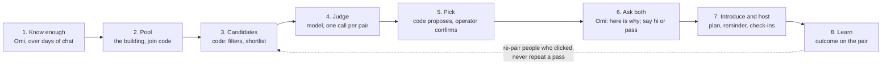

# Matching: the flow and the algorithm

Written 5 November 2026. A design, not a build log. Matching was parked on 1 November before any live run; this page is the plan for when it resumes, and it names the API the match screens need. It builds on what is on main (`src/agent/matching/`, progress rows 7a to 7c) and on [problem.md](problem.md): one building, one match day a week, pairs who meet for a chai, and the one measure (met within 30 days; still in touch at day 30).

Rules it keeps: code computes facts and picks, a model judges and writes, code checks every line the model wrote against the cards. Nothing used for matching that the user did not say. Private areas (values, stories, deal-breakers) are weighed only with both consents and never shown to anyone. No percentages anywhere a user can see.

## 1. The flow

| Step | Who | What happens | State |
|---|---|---|---|
| 1. Know enough | Omi | Vibe card reaches "ready to match"; the meet facts (area, free time; food and budget are good to have) are known from memories. | Built (7a) |
| 2. Pool | Operator, user | A pool per building with a join code and a match weekday. Joining with the code is the user's consent to be matched in that pool. | Built (7b), API only |
| 3. Candidates | Code | Ready members of the pool, minus hard filters (section 3.2). Ordered by a shortlist score (3.3) when the pool is big. | Partly built; score to replace |
| 4. Judge | Model | One call per candidate pair: fit, reasons, one accepted difference, an icebreaker, and a clash flag (3.4). | Built; clash and meet fit to add |
| 5. Pick | Code, operator | Code proposes a set of pairs where each ready person appears once, plus a group of three or four in a thin week. The operator sees it and can swap before anything goes out. | To build (3.5); operator page is UI work |
| 6. Ask both | Omi | Each person hears, in their own chat, that there is someone in their building and why. "Say hi" or "Not for me". Both yes within two days leads to the introduction. | To build (3.6) |
| 7. Introduce and host | Omi | Both names, the plan (place, time), a reminder the day before, check-ins at day 3 and day 30. | Built (7c), not run live |
| 8. Learn | Omi, code | What the user says came of it is recorded on the pair. Outcomes feed the next match day (3.7). | Built (7c); learning rules to add |

## 2. What each person sees

- **Before match day.** The Matches page says how close they are ("Matches need Ready to match") with the blockers in plain words. API: `GET /api/me/match-readiness` (exists).
- **Match day.** A match card: the other person's first name, two or three reasons written from both cards, one difference they could live with, one starter line. Never the other person's vibe notes, never a score. Two buttons: "Say hi" and "Not for me". On WhatsApp the same arrives as Omi's message, and the answer is read from the reply.
- **Both said hi.** Omi tells both: the plan (a place from the places tool, a time that fits both free times), and from then on they talk to each other: in a match chat in the app, or by number once both agree to share it. Omi does not carry messages between them.
- **One passed, or no answer in two days.** The other person hears "not this week" and nothing else. A pass is never explained to the other side, and the pair is never proposed again.
- **After.** Omi asks how it went at day 3 and again at day 30. If they clicked, Omi may pair them again for a group later; if not, it says nothing more about it.

## 3. The algorithm

### 3.1 Readiness (built)

A user can be matched when the vibe card is at `ready_to_match` (every basic area clear, three deeper ones) and the required meet facts are known. Nothing here changes. The only addition: readiness is computed for the whole pool at once on match day, so the operator sees who just missed it and Omi gets the missing facts as a goal for the coming week.

### 3.2 Candidates and hard filters (code)

Within one pool, every pair of ready members, minus:

- pairs already proposed to either side before (a pass or a no-show is final; a "met" pair is not proposed again as a pair, but may be put in a group);
- anyone either side has reported or blocked (block path is not built yet; the filter should exist from day one);
- pairs whose meet facts cannot work: no overlap at all between stated free times when both are known. Area is not a filter inside one building.

A thin pool stays a pool: with fewer than three ready people the match day says "one more week" and nothing else runs.

### 3.3 Shortlist score (code, replaces the current one)

Today's score is 0.6 times coverage plus 0.4 times word overlap between lines. Word overlap rewards the same words, not the same vibe ("loves trekking" and "weekend hikes" score low), so it is a poor shortlist.

Proposed, once embeddings per vibe line exist (roadmap item 15): embed each area line; for each comparable area take the cosine similarity of the two lines; combine with per-area weights set from what predicts adult friendship (section 4), then multiply by coverage (how many areas could be compared out of eleven).

| Area | Weight | Why |
|---|---|---|
| humor | 3 | Shared sense of humour is among the best predictors of closeness |
| interests | 3 | Shared hobbies, same |
| values | 3 | Shared moral beliefs, same; only with both consents, never shown |
| friend_wish | 2 | What they each want from a friend should be the same kind of thing |
| stories, accepts | 1 | Context for the judge more than a signal |
| social_energy, keeping_in_touch, daily_life | compatibility, not similarity | A planner and a spontaneous person can click; someone who wants daily texts and someone who answers monthly will not. The judge reads these; the score only checks that both are known |
| conflict, deal_breakers | 0 in the score | Deal-breakers are a veto in the judge, not a similarity |

The shortlist only orders candidates. It never decides a match and is never shown to a user. While a pool is under about forty people, every pair is judged and the shortlist is unused; the operator view can keep showing it as a sort order.

### 3.4 The judge (model, built; two fields to add)

One call per pair, on the request-check model (Qwen3 235B, the default today). Input: both first names, the comparable areas' lines, which of them are shareable, and the area meanings. Output, as today: fit yes, maybe or no; up to three reasons each from a different shareable area; one accepted difference; an icebreaker; why not. Code drops any reason, difference or icebreaker that names a non-shareable area, and turns a "yes" with no surviving reason into "maybe".

Two additions:

- `clash`: whether anything in one person's deal-breakers or "accepts" lines is contradicted by the other person's lines, with the area it comes from. A clash drops the pair in code before the pick. It is never shown to anyone; the user just does not get that match. Deal-breakers are private, so the clash is checked only when both consented; without consent the pair is judged on the rest, which is the same rule as today.
- `meet_fit`: from the meet facts (free time, food, budget), whether a first meet is easy, awkward or unknown, with the one line the plan should respect ("both free on weekday evenings", "one is vegetarian"). The host step uses it when it suggests a place and time.

Order matters to a pairwise judge, so the two people are put in random order per call, and the model gives no number: only fit and words. Code keeps the raw output on the pair, encrypted, as it does today.

Cost for a pool of forty, every pair judged (780 pairs, about 1.5K tokens in and 300 out each): about $0.30 per match day on the current judge model. Pools of a few hundred would need the shortlist (judge the top five per person).

### 3.5 Picking pairs (code, new)

Input: all judged pairs of the pool with fit, number of reasons, the accepted difference, meet fit and the shortlist score. Output: a proposal where each ready person appears at most once.

1. Drop pairs with a clash, fit "no", or meet fit "awkward" when the pool has other options for both people.
2. Order the rest: fit yes before maybe; then more reasons; then meet fit easy before unknown; then the shortlist score.
3. Walk the list, taking a pair when both people are still free (greedy). Greedy is enough at this size; a proper assignment that maximises the total can replace it later without changing anything around it.
4. Left-over ready people: if three or more, one group of three or four from the best-judged pairs among them (groups are the thin-week answer in problem.md); if one or two, they hear "one more week".
5. The operator sees the proposal on the operator page: each pair with the reasons, the difference and the meet line, the group, and who waits. They can swap two pairs, drop one, or add a pair from the judged list. They confirm; nothing is said to a user before that. Later, when hand-checking stops scaling, confirm becomes automatic and the operator only gets a report.

### 3.6 Ask both (Omi, new)

After confirm, two durable jobs per pair (one per person), in their daytime, on their channel (WhatsApp or Telegram when linked, else the app):

- Omi says there is someone in their building it thinks they would get along with, gives the first name, the reasons (shareable areas only, both names in each), the difference, and asks whether to introduce them. This is written by the reply model from the facts code gives it, the same way the introduction works today.
- The answer is recorded through a tool, `answer_match(pair_id, accept | pass, note)`, enabled only for users with an open ask. In the app the two buttons call `POST /api/me/matches/{pair_id}/answer` directly.
- Both accept: the pair becomes `introduced` and the existing host flow runs (introduction with the plan, reminder, check-ins). The plan's place and time come from the operator today; with `meet_fit` in hand, Omi can propose both and the operator only confirms.
- One pass: the pair becomes `declined`; the other person hears "not this week" in their next ask or in the week's "one more week" message, never why.
- No answer in two days: treated as a pass for this week; the pair may be proposed again once, next week, if both are still ready.

Open question in problem.md settled here: both sides accept before any introduction. First names only in the ask; nothing else about the other person until both said yes.

### 3.7 Learn (code; rules, not weights, until there is data)

Every pair keeps: the judge output, the shortlist score, who accepted, whether they met, and the day 3 and day 30 answers. That is the data set. Until there are about fifty pairs with a day 30 answer, nothing is learned automatically; three fixed rules apply:

- A pair that clicked (still talking at day 3 or 30) is a candidate for a group with others later, and both are marked as reliable for the operator.
- A no-show counts against being proposed first the following week.
- A pass is final for that pair.

With fifty or more outcomes, the first analysis is simple: which judge fields and which area similarities separated "still talking at day 30" from the rest. Area weights in 3.3 are changed by hand from that, with the numbers written in progress.md.

Ground truth before any of that: the friend compatibility check in product-direction (invite a friend, both chat with Omi, see the result). Pairs who are already friends should come out "yes" from the judge far more often than random pairs from the pool. That is the first evaluation of the judge prompt and can run as soon as two real cards exist.

## 4. Why these choices

- **Nearness first.** Being in the same place is the strongest and most consistent predictor of who becomes friends (Newcomb's dorm studies; roommates twice as often as floormates). The building pool is the algorithm's biggest decision, and it is already made.
- **Similarity on the right things.** A 2013 study of adult friendships found that sharing a sense of humour, hobbies and interests, moral beliefs, and being from the same area were the best predictors of closeness and altruism. That is where the weights in 3.3 come from. Evidence for "opposites attract" is weak; it shows up, if at all, in skills and temperament, which is why social energy and keeping in touch are checked for compatibility, not similarity.
- **Humour grows.** In friendship pairs, humour styles converge over time rather than start aligned, so a weak humour overlap is not a veto.
- **What the group-dinner apps do.** Timeleft, 222 and Pie all run a questionnaire into personality types and seat four to six people by type, age and language; 222 re-pairs people who clicked after feedback. Omiryn's difference is weeks of real chat instead of a quiz, and pairs in a building instead of a table across the city. Two things worth copying: groups when pairs are thin, and re-pairing people who clicked.
- **Retrieve, then judge.** In ranking work outside matchmaking (recruitment, product pairs), embeddings shortlist and a model reranks a small top-N; pairwise judgments are more consistent than absolute scores but show order bias and run-to-run instability. Hence: random order per call, no number from the model, code does the ordering and the pick.

Sources: [TechCrunch on 222](https://techcrunch.com/2022/11/14/2440702/), [Timeleft vs 222](https://nexspark.org/journal/timeleft-vs-222), [Pie and others compared](https://agiletech.vn/blog/best-apps-to-make-friends/), [friendship predictors, textbook summary](https://psywww.com/intropsych/ch16-sfl/friendship.html), [similarity and adult friendship, Oxford 2013](https://www.psy.ox.ac.uk/publications/417188), [humour style similarity in friendship dyads](https://strathprints.strath.ac.uk/54683/), [LLM reranking after embedding retrieval](https://arxiv.org/pdf/2605.09760), [calibrated ranking for person-job fit](https://arxiv.org/pdf/2601.10321).

## 5. Build order

Each step is small and testable on its own; the order follows problem.md (one real pair end to end before polish).

| # | Piece | Where | Size |
|---|---|---|---|
| 1 | Judge: `clash` and `meet_fit` fields, random order, code validation | `matching/compatibility.py` | small |
| 2 | Pick: filters, ordering, greedy pairs, group, "one more week" | new `matching/pick.py` | medium |
| 3 | Ask both: jobs, `answer_match` tool, `POST /api/me/matches/{id}/answer`, pair statuses `asked`, `accepted_a`, `declined` | `matching/hosting.py`, `tools/`, `api/routes/` | medium |
| 4 | `GET /api/me/matches` for the match card | `api/routes/` | small |
| 5 | Operator page (confirm, swap, drop) | web, UI session | medium |
| 6 | Match chat or number sharing with consent | storage, api, web | large; decide first |
| 7 | Shortlist on embeddings, per-area weights | `matching/`, roadmap item 15 | medium; only when pools pass forty |
| 8 | Judge evaluation on known friend pairs | `scripts/evals/` | small, needs two real cards |

Steps 1 to 4 and 8 need no UI and can be built now. Step 6 needs a decision (section 6).

## 6. For the match screens (the UI session)

What the screens need, so the two tracks meet in the middle:

- `GET /api/me/match-readiness` (exists): `ready`, `milestone`, `blockers[]`.
- `GET /api/me/matches` (to build): a list of cards, newest first:
  `{pair_id, status, name, reasons: [{area, text}], difference: {area, text} | null, icebreaker, plan: {place, when} | null, asked_at, answer_by}`.
  `status` is one of `asked` (waiting for you), `waiting` (you said hi, the other has not answered), `introduced` (both said hi; plan shown), `met`, `still_talking`, `declined`, `no_show`, `expired`. No score field, on purpose.
- `POST /api/me/matches/{pair_id}/answer` (to build): `{"answer": "accept" | "pass"}`. Returns the card with its new status.
- Match chat: not designed here; see the open decision below.

Pool and pair statuses already in the API (`GET /api/me/pools`) stay; the card list is the user-facing view of the same pairs.

## 7. Open decisions

1. **Where they talk after the introduction.** A match chat inside the app (what the Matches mock shows) or phone numbers shared once both agree. WhatsApp-first residents have no app open, which argues for numbers; a chat in the app gives a report-and-block path and the day 3 signal for free. Recommendation: numbers with consent first for the building pilot, the in-app chat when the app is the front door.
2. **Who confirms the proposal.** Operator confirm on every match day for the pilot; automatic once ten match days have gone by without a swap. Recommendation: as written.
3. **Groups.** Three or four people when pairs are thin, as problem.md says, or pairs only until the pair flow is proven. Recommendation: pairs only for the first two match days.
4. **Judge model.** The request-check model today. A stronger judge costs more per pair but there are under a thousand pairs a week per building; the evaluation in step 8 decides, not a guess.
