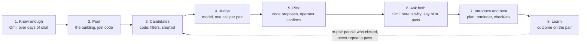

# Matching: the flow and the algorithm

Written 5 November 2026. A design, not a build log. Matching was parked on 1 November before any live run; this page is the plan for when it resumes, and it names the API the match screens need. It builds on what is on main (`src/agent/matching/`, progress rows 7a to 7c) and on [problem.md](problem.md): one building, one match day a week, pairs who meet for a chai, and the one measure (met within 30 days; still in touch at day 30).

Rules it keeps: code computes facts and picks, a model judges and writes, code checks every line the model wrote against the cards. Nothing used for matching that the user did not say. Private areas (values, stories, deal-breakers) are weighed only with both consents and never shown to anyone. No percentages anywhere a user can see.

## 1. The flow

| Step | Who | What happens | State |
|---|---|---|---|
| 1. Know enough | Omi | Vibe card reaches "ready to match"; the meet facts (area, free time; food and budget are good to have) are known from memories. | Built (7a) |
| 2. Pool | Operator, user | A pool per building with a join code and a match weekday. Joining with the code is the user's consent to be matched in that pool. | Built (7b), API only |
| 3. Candidates | Code | Ready members of the pool, minus hard filters (section 3.2). Ordered by a shortlist score (3.3) when the pool is big. | Partly built; score to replace |
| 4. Judge | Model | One call per candidate pair: fit, reasons, one accepted difference, an icebreaker, and a clash flag (3.4). | Built; clash and meet fit to add |
| 5. Pick | Code, operator | Code proposes a set of pairs where each ready person appears once, plus a group of three or four in a thin week. The operator sees it and can swap before anything goes out. | To build (3.5); operator page is UI work |
| 6. Ask both | Omi | Each person hears, in their own chat, that there is someone in their building and why. "Say hi" or "Not for me". Both yes within two days leads to the introduction. | To build (3.6) |
| 7. Introduce and host | Omi | Both names, the plan (place, time), a reminder the day before, check-ins at day 3 and day 30. | Built (7c), not run live |
| 8. Learn | Omi, code | What the user says came of it is recorded on the pair. Outcomes feed the next match day (3.7). | Built (7c); learning rules to add |

## 2. What each person sees

- **Before match day.** The Matches page says how close they are ("Matches need Ready to match") with the blockers in plain words. API: `GET /api/me/match-readiness` (exists).
- **Match day.** A match card: the other person's first name, two or three reasons written from both cards, one difference they could live with, one starter line. Never the other person's vibe notes, never a score. Two buttons: "Say hi" and "Not for me". On WhatsApp the same arrives as Omi's message, and the answer is read from the reply.
- **Both said hi.** Omi tells both: the plan (a place from the places tool, a time that fits both free times), and from then on they talk to each other: in a match chat in the app, or by number once both agree to share it. Omi does not carry messages between them.
- **One passed, or no answer in two days.** The other person hears "not this week" and nothing else. A pass is never explained to the other side, and the pair is never proposed again.
- **After.** Omi asks how it went at day 3 and again at day 30. If they clicked, Omi may pair them again for a group later; if not, it says nothing more about it.

## 3. The algorithm

### 3.1 Readiness (built)

A user can be matched when the vibe card is at `ready_to_match` (every basic area clear, three deeper ones) and the required meet facts are known. Nothing here changes. The only addition: readiness is computed for the whole pool at once on match day, so the operator sees who just missed it and Omi gets the missing facts as a goal for the coming week.

### 3.2 Candidates and hard filters (code)

Within one pool, every pair of ready members, minus:

- pairs already proposed to either side before (a pass or a no-show is final; a "met" pair is not proposed again as a pair, but may be put in a group);
- anyone either side has blocked, in any pool (built 2026-11-13: table `match_blocks`, checked by the pick, the manual pair and the operator's suggestions);
- pairs whose meet facts cannot work: no overlap at all between stated free times when both are known. Area is not a filter inside one building.

A thin pool stays a pool: with fewer than three ready people the match day says "one more week" and nothing else runs.

### 3.3 Shortlist score (code, replaces the current one)

Today's score is 0.6 times coverage plus 0.4 times word overlap between lines. Word overlap rewards the same words, not the same vibe ("loves trekking" and "weekend hikes" score low), so it is a poor shortlist.

Proposed, once embeddings per vibe line exist (roadmap item 15): embed each area line; for each comparable area take the cosine similarity of the two lines; combine with per-area weights set from what predicts adult friendship (section 4), then multiply by coverage (how many areas could be compared out of eleven).

| Area | Weight | Why |
|---|---|---|
| humor | 3 | Shared sense of humour is among the best predictors of closeness |
| interests | 3 | Shared hobbies, same |
| values | 3 | Shared moral beliefs, same; only with both consents, never shown |
| friend_wish | 2 | What they each want from a friend should be the same kind of thing |
| stories, accepts | 1 | Context for the judge more than a signal |
| social_energy, keeping_in_touch, daily_life | compatibility, not similarity | A planner and a spontaneous person can click; someone who wants daily texts and someone who answers monthly will not. The judge reads these; the score only checks that both are known |
| conflict, deal_breakers | 0 in the score | Deal-breakers are a veto in the judge, not a similarity |

The shortlist only orders candidates. It never decides a match and is never shown to a user. While a pool is under about forty people, every pair is judged and the shortlist is unused; the operator view can keep showing it as a sort order.

### 3.4 The judge (model, built; two fields to add)

One call per pair, on the request-check model (Qwen3 235B, the default today). Input: both first names, the comparable areas' lines, which of them are shareable, and the area meanings. Output, as today: fit yes, maybe or no; up to three reasons each from a different shareable area; one accepted difference; an icebreaker; why not. Code drops any reason, difference or icebreaker that names a non-shareable area, and turns a "yes" with no surviving reason into "maybe".

Two additions:

- `clash`: whether anything in one person's deal-breakers or "accepts" lines is contradicted by the other person's lines, with the area it comes from. A clash drops the pair in code before the pick. It is never shown to anyone; the user just does not get that match. Deal-breakers are private, so the clash is checked only when both consented; without consent the pair is judged on the rest, which is the same rule as today.
- `meet_fit`: from the meet facts (free time, food, budget), whether a first meet is easy, awkward or unknown, with the one line the plan should respect ("both free on weekday evenings", "one is vegetarian"). The host step uses it when it suggests a place and time.

Order matters to a pairwise judge, so the two people are put in random order per call, and the model gives no number: only fit and words. Code keeps the raw output on the pair, encrypted, as it does today.

Cost for a pool of forty, every pair judged (780 pairs, about 1.5K tokens in and 300 out each): about $0.30 per match day on the current judge model. Pools of a few hundred would need the shortlist (judge the top five per person).

### 3.5 Picking pairs (code, new)

Input: all judged pairs of the pool with fit, number of reasons, the accepted difference, meet fit and the shortlist score. Output: a proposal where each ready person appears at most once.

1. Drop pairs with a clash, fit "no", or meet fit "awkward" when the pool has other options for both people.
2. Order the rest: fit yes before maybe; then more reasons; then meet fit easy before unknown; then the shortlist score.
3. Walk the list, taking a pair when both people are still free (greedy). Greedy is enough at this size; a proper assignment that maximises the total can replace it later without changing anything around it.
4. Left-over ready people: if three or more, one group of three or four from the best-judged pairs among them (groups are the thin-week answer in problem.md); if one or two, they hear "one more week".
5. The operator sees the proposal on the operator page: each pair with the reasons, the difference and the meet line, the group, and who waits. They can swap two pairs, drop one, or add a pair from the judged list. They confirm; nothing is said to a user before that. Later, when hand-checking stops scaling, confirm becomes automatic and the operator only gets a report.

### 3.6 Ask both (Omi, new)

After confirm, two durable jobs per pair (one per person), in their daytime, on their channel (WhatsApp or Telegram when linked, else the app):

- Omi says there is someone in their building it thinks they would get along with, gives the first name, the reasons (shareable areas only, both names in each), the difference, and asks whether to introduce them. This is written by the reply model from the facts code gives it, the same way the introduction works today.
- The answer is recorded through a tool, `answer_match(pair_id, accept | pass, note)`, enabled only for users with an open ask. In the app the two buttons call `POST /api/me/matches/{pair_id}/answer` directly.
- Both accept: the pair becomes `introduced` and the existing host flow runs (introduction with the plan, reminder, check-ins). The plan's place and time come from the operator today; with `meet_fit` in hand, Omi can propose both and the operator only confirms.
- One pass: the pair becomes `declined`; the other person hears "not this week" in their next ask or in the week's "one more week" message, never why.
- No answer in two days: treated as a pass for this week; the pair may be proposed again once, next week, if both are still ready.

Open question in problem.md settled here: both sides accept before any introduction. First names only in the ask; nothing else about the other person until both said yes.

### 3.7 Learn (code; rules, not weights, until there is data)

Every pair keeps: the judge output, the shortlist score, who accepted, whether they met, and the day 3 and day 30 answers. That is the data set. Until there are about fifty pairs with a day 30 answer, nothing is learned automatically; three fixed rules apply:

- A pair that clicked (still talking at day 3 or 30) is a candidate for a group with others later, and both are marked as reliable for the operator.
- A no-show counts against being proposed first the following week.
- A pass is final for that pair.

With fifty or more outcomes, the first analysis is simple: which judge fields and which area similarities separated "still talking at day 30" from the rest. Area weights in 3.3 are changed by hand from that, with the numbers written in progress.md.

Ground truth before any of that: the friend compatibility check in product-direction (invite a friend, both chat with Omi, see the result). Pairs who are already friends should come out "yes" from the judge far more often than random pairs from the pool. That is the first evaluation of the judge prompt and can run as soon as two real cards exist.

## 4. Why these choices

- **Nearness first.** Being in the same place is the strongest and most consistent predictor of who becomes friends (Newcomb's dorm studies; roommates twice as often as floormates). The building pool is the algorithm's biggest decision, and it is already made.
- **Similarity on the right things.** A 2013 study of adult friendships found that sharing a sense of humour, hobbies and interests, moral beliefs, and being from the same area were the best predictors of closeness and altruism. That is where the weights in 3.3 come from. Evidence for "opposites attract" is weak; it shows up, if at all, in skills and temperament, which is why social energy and keeping in touch are checked for compatibility, not similarity.
- **Humour grows.** In friendship pairs, humour styles converge over time rather than start aligned, so a weak humour overlap is not a veto.
- **What the group-dinner apps do.** Timeleft, 222 and Pie all run a questionnaire into personality types and seat four to six people by type, age and language; 222 re-pairs people who clicked after feedback. Omiryn's difference is weeks of real chat instead of a quiz, and pairs in a building instead of a table across the city. Two things worth copying: groups when pairs are thin, and re-pairing people who clicked.
- **Retrieve, then judge.** In ranking work outside matchmaking (recruitment, product pairs), embeddings shortlist and a model reranks a small top-N; pairwise judgments are more consistent than absolute scores but show order bias and run-to-run instability. Hence: random order per call, no number from the model, code does the ordering and the pick.

Sources: [TechCrunch on 222](https://techcrunch.com/2022/11/14/2440702/), [Timeleft vs 222](https://nexspark.org/journal/timeleft-vs-222), [Pie and others compared](https://agiletech.vn/blog/best-apps-to-make-friends/), [friendship predictors, textbook summary](https://psywww.com/intropsych/ch16-sfl/friendship.html), [similarity and adult friendship, Oxford 2013](https://www.psy.ox.ac.uk/publications/417188), [humour style similarity in friendship dyads](https://strathprints.strath.ac.uk/54683/), [LLM reranking after embedding retrieval](https://arxiv.org/pdf/2605.09760), [calibrated ranking for person-job fit](https://arxiv.org/pdf/2601.10321).

## 5. Build order

Each step is small and testable on its own; the order follows problem.md (one real pair end to end before polish).

| # | Piece | Where | Size |
|---|---|---|---|
| 1 | Judge: `clash` and `meet_fit` fields, random order, code validation | `matching/compatibility.py` | built 2026-11-07 (progress 7f) |
| 2 | Pick: filters, ordering, greedy pairs, group, "one more week" | `matching/pick.py` | built 2026-11-08 (progress 7h) |
| 3 | Ask both: jobs, `answer_match` tool, `POST /api/me/matches/{id}/answer`, pair statuses `asked`, `expired`, `declined` | `matching/asking.py`, `tools/match_answer.py`, `api/routes/matches.py` | built 2026-11-08 (progress 7h) |
| 4 | `GET /api/me/matches` for the match card | `api/routes/matches.py` | built 2026-11-08 (progress 7h) |
| 5 | Operator page (confirm, swap, drop) | web, UI session | medium |
| 6 | Match chat or number sharing with consent | storage, api, web | large; decide first |
| 7 | Shortlist on embeddings, per-area weights | `matching/`, roadmap item 15 | medium; only when pools pass forty |
| 8 | Judge evaluation on known friend pairs | `scripts/evals/` | small, needs two real cards |

Steps 1 to 4 and 8 need no UI and can be built now. Step 6 needs a decision (section 6).

## 6. For the match screens (the UI session)

What the screens need, so the two tracks meet in the middle:

- `GET /api/me/match-readiness` (exists): `ready`, `milestone`, `blockers[]`.
- `GET /api/me/matches` (to build): a list of cards, newest first:
  `{pair_id, status, name, reasons: [{area, text}], difference: {area, text} | null, icebreaker, plan: {place, when} | null, asked_at, answer_by}`.
  `status` is one of `asked` (waiting for you), `waiting` (you said hi, the other has not answered), `introduced` (both said hi; plan shown), `met`, `still_talking`, `declined`, `no_show`, `expired`. No score field, on purpose.
- `POST /api/me/matches/{pair_id}/answer` (to build): `{"answer": "accept" | "pass"}`. Returns the card with its new status.
- Match chat: not designed here; see the open decision below.

Pool and pair statuses already in the API (`GET /api/me/pools`) stay; the card list is the user-facing view of the same pairs.

## 7. Open decisions

1. **Where they talk after the introduction.** Decided 2026-11-13: a chat inside the app. The backend is built (`src/agent/matching/pair_chat.py`, `src/api/routes/match_chat.py`, tables `match_messages`, `match_chat_reads`, `match_blocks`, `match_reports`); the screen is not. Omi never reads the chat and does not carry messages; a block or a report closes it for both. Omi points people to the chat only once `MATCH_CHAT_IN_APP=true` is set, which waits for the screen. Sharing numbers is not planned now.
2. **Who confirms the proposal.** Operator confirm on every match day for the pilot; automatic once ten match days have gone by without a swap. Recommendation: as written.
3. **Groups.** Three or four people when pairs are thin, as problem.md says, or pairs only until the pair flow is proven. Recommendation: pairs only for the first two match days.
4. **Judge model.** The request-check model today. A stronger judge costs more per pair but there are under a thousand pairs a week per building; the evaluation in step 8 decides, not a guess.

## 8. The deep layer: matching on what people said, not only on the card

Added 7 November 2026. Section 3 compares eleven one-line summaries per person. That is the shallow version the vibe card was already called. The deep layer gives the judge three more kinds of evidence per pair, all computed by code from what each person actually said to Omi, with the model judging and code checking as before.

### 8.1 Three sources of evidence

| Source | What it is | Who computes | Used for |
|---|---|---|---|
| A. Vibe lines | The eleven areas, as today | background model, proven | reasons, difference, icebreaker |
| B. Touchpoints | Pairs of memories, one from each person, that are about the same thing: both love it, one needs what the other is, or they clash | code, from the memory embeddings that already exist (same multilingual model) | reasons (when allowed), clash, chemistry |
| C. Talk style | How each person writes to Omi: length, pace, hours, Hinglish share, laugh markers, who starts sessions | code, from the person's own messages | compatibility lines for the judge, shortlist |
| D. Patterns (later) | How they talk about friends, how many they keep, conflict stories, what repeats | code, from the memory graph (`about` names, relationship memories, repeats) | judge context only, never a reason |

### 8.2 Touchpoints (source B)

For users A and B: take each active memory of A with purpose `matching` and sensitivity `standard`; find the most similar memory of B with the same rules by cosine between their stored embeddings; keep pairs above a floor. Each touchpoint is the two statements and the similarity. Code ranks them and sends the top six to the judge, with `about` names removed. The judge labels each: shared, complementary, clash or nothing, and may use shared and complementary ones in a reason.

Rules: a memory with `sensitive` or `highly_sensitive` sensitivity never leaves its owner's account, nor does a retracted one or a how-to-talk rule. A touchpoint reaches a reason only when both memories are `matching` purpose and `standard` sensitivity, and the reason text is checked by code against both statements: words that match neither are dropped with the reason. A user never sees the other person's statement, only the reason written from both.

### 8.3 Talk style (source C)

A style card per user, rebuilt with the user card: average message length, share of short messages, questions, laugh markers (haha, lol, 😂 and the like), emoji, script and language mix (Devanagari, romanised Hindi, English), median gap between their own messages inside a session, the hours they usually write, and how often they open a session themselves. Nothing here is a judgment; it is counts. For a pair, code turns the two cards into a few plain lines: "both write mostly Hinglish", "both active after 9 pm", "A writes long, B short", "both laugh in text often". The judge reads those lines as compatibility facts; nothing from them is shown to a user. The shortlist may use language mix and active hours as hard compatibility.

### 8.4 The evidence pack and the judge

Per pair, code builds one JSON pack: both first names; comparable vibe lines with which are shareable; up to six touchpoints with their allowed-in-reason flag; the style lines; the meet facts. One judge call returns, as in 3.4, fit, reasons (each now carries its source: an area or a touchpoint index), difference, icebreaker, why_not, clash, meet_fit, and a `chemistry` note (one sentence on whether a conversation between them would flow, for the operator and the evaluation, never shown to users). Code validation extends to sources: a reason whose source is not allowed is dropped. About 2.5K tokens in per pair; a pool of forty judged in full stays under $1 per match day.

### 8.5 How we know it is better

The judge's job is to find pairs who will click. The first ground truth is pairs who already do: the friend compatibility check (invite a friend, both chat with Omi). The evaluation runs the judge three ways on the same pairs, vibe only, vibe plus touchpoints, and all three sources, against known friend pairs mixed with random pairs from the same pool, and reports how many known friends come out "yes" at the rate of random pairs that also do. The version that separates them best is the one that ships; weights in 3.3 are set from the same runs. Later, day 30 outcomes replace known friends as the truth.

### 8.6 Build order for the deep layer

| # | Piece | Where | Size |
|---|---|---|---|
| D1 | Style card: counts per user, rebuilt with the user card; pair lines | `matching/style.py`, table `agent_user_style` | built 2026-11-07 (progress 7d) |
| D2 | Touchpoints from stored memory embeddings, with the sensitivity and purpose rules | `matching/touchpoints.py` | built 2026-11-07 (progress 7e) |
| D3 | Evidence pack, judge prompt v2 with sources, validation of sources and words | `matching/compatibility.py` | built 2026-11-07 (progress 7f) |
| D4 | Evaluation on known friend pairs, four runs (v1, v2 vibe only, plus touchpoints, plus style and meet) | `scripts/evals/run_match_judge_evals.py` | built 2026-11-07 (progress 7g); not yet run |
| D5 | Patterns from the memory graph as judge context | `matching/patterns.py` | later |

D1 to D3 come before the flow pieces in section 5, since they change what the judge returns and what the pick orders on.

## 9. Research of 14 November 2026: where matching should go next

Full notes: `reports/matching-research-2026-11-14.md` (not in git; the page is https://claude.ai/artifact/VdgmvFrVmPmKM3iAZzM28K). Nothing here is built or decided yet.

What the research found:

- From profiles, nobody can predict which two people will click (Joel, Eastwick, Finkel 2017). Models that read real speed-date talks do only slightly better than chance (Matz and others 2024). So a judge's "yes" is a weak signal, and the system that wins is the one that knows people best, gives a true reason, makes a try cheap, and learns from outcomes.
- Other products either introduce people but know them from swipes, a quiz or one interview (Tinder, Hinge, Bumble, Timeleft, 222, Known, Sitch, Amata, Ditto, Series, Boardy), or know people deeply but introduce nobody (Replika, Pi, Tolan). None found does both.

Proposed direction, in build order:

1. The judge chooses among several candidates instead of approving one pair; "nobody this week" is allowed. Tested on made-up people with planted good and bad pairs.
2. Readiness from memories (enough matchable memories plus the basics). The vibe card stays for the person to read but is no longer a gate.
3. A "what I want now" view per person from current-focus memories, and scoring in both directions (what one wants against what the other gives).
4. Open matching with filters (language, city or anywhere, age band, friend or dating, blocks); no join code. The shortlist uses stored memory vectors, top 20 per person.
5. Rules for several matches at once, and outcome counts (said hi, messages in three days, still talking on day 7 and 30, called off, blocked). Omi never reads the chat.
6. Learning each person's taste from outcomes, once about fifty real pairs exist.
7. Experiment: a practice chat between two stand-ins built from each person's memories and style, rated by a second model (early studies: 64% against 48% for profiles alone).

Open decisions: card no longer a gate; friends first or dating too; counts inside pair chats; budget for the practice chat experiment.

## 10. Judge v3: choosing among candidates (built 15 November 2026, not in the live flow)

Step 1 of section 9. Code: `src/agent/matching/choose.py`; test: `src/agent/evals/matching/choose_eval.py`, run with `scripts/evals/run_match_choose_evals.py`. Judges v1 and v2 are unchanged and v2 still runs the live flow.

### 10.1 What changed

- **One person, up to five candidates.** v1 and v2 look at one pair and say yes, maybe or no. Asked that way the model finds something in common for almost every pair. v3 has to rank the candidates against each other, and "nobody" is an allowed answer.
- **Notes, not a card.** Each person is a numbered list of notes: every vibe line with proof, then statements from memory. No minimum number of card areas. With more than twenty statements, half the room goes to the ones closest in meaning to what the other side said (stored vectors), the rest to the most important and newest.
- **A pull level per candidate**: strong, some or none. The first of the order is best only when its pull is strong. Code sorts the order so it agrees with the levels.
- **A second look.** Ranking grades on a curve: the least bad of a weak set comes out "strong". So each candidate the ranking called strong is shown to the judge again, alone, in order, until one holds (three looks at most). If none holds there is no best.
- **Clash.** A clash has to name one note from each side. A candidate with a clash goes last and is never best.

### 10.2 What leaves an account, and what a reason may use

The same rules as touchpoints: only active, standard-sensitivity memories that are not how-to-talk rules, names taken out; private vibe areas only when that person allowed it. A reason names one note of the person and one of the best candidate; code keeps it only when both notes may back a reason (a non-private vibe line, or a memory with the `matching` purpose) and the sentence takes a content word from each. User ids never reach the judge: candidates are `c1` to `c5`, shuffled per call.

### 10.3 The test

Nine made-up people: the six in `personas.py` (three planted friend pairs) and three decoys in `choose_eval.py`. A decoy shares the surface with one pair (same hobbies, same hours) and does what they cannot stand. Three tests, three rounds each with a new candidate order:

| Test | Candidates | Right answer |
|---|---|---|
| With the friend | the friend, the decoy, three others | the friend is best; the decoy is a clash and last |
| Without the friend | the decoy, four others | nobody |
| One at a time | one candidate per call (how v1 and v2 are asked) | approve the friend only |

Two sources. "Fixtures": each person's notes are the persona's own sentences, so the judge is tested alone with good evidence. "Database": the six people seeded on 10 November through the real pipeline (chats with Omi, background memory, vibe card), without decoys.

### 10.4 Results, 15 November 2026 (Qwen3 235B, the default judge model)

| Measure | Fixtures, all notes | Fixtures, 6 notes each | Database |
|---|---|---|---|
| Friend chosen as best | 18/18 | 15/18 | 9/18 (guessing: 4 or 5) |
| Friend's average place | 1.0 of 5 | 1.39 of 5 | 2.17 of 4 |
| Decoy marked as a clash | 18/18 | 17/18 | no decoys |
| Without the friend: said nobody | 18/18 | 14/18 (4 wrong picks) | 1/18 |
| Without the friend: chose the decoy | 0/18 | 0/18 | no decoys |
| One at a time: friend approved | 6/6 | 5/6 | 6/6 |
| One at a time: someone else approved | 0/12 | 0/12 | 9/12 |

Before the pull levels and the second look, on the same fixtures: one at a time approved 11 of 12 non-friends (the "yes to everyone" problem), and without the friend the judge still picked someone 15 of 18 times. With pull levels only: 12 of 18. With the second look: 0 of 18.

### 10.5 What it means

- With good notes about each person the judge is right every time, including "nobody" and the decoys. The judge is no longer the weak part.
- With six notes a person it still finds the friend 15 of 18 times and says "nobody" for the other 3, which is the safe way to fail. Without the friend it made a wrong pick 4 of 18 times: the less Omi knows, the more a thin overlap passes for a match.
- On the seeded people it is near guessing. Their memories are mostly made-up stories from playful chats ("saw vada pav spawning in PUBG at 2 am"), not who they are, and the person with the most notes looks like a match for everyone. What Omi keeps about a person is now the weak part: step 2 of section 9. The seeded chats are also part of the problem, since the test people drift into games with Omi.
- No memory of the seeded people carries the `matching` purpose (0 of 119; the background writer never picks it), so today a reason can only come from a vibe line. Whether an ordinary memory may back a reason once a person turned matching on is an open decision.
- Judge calls are not written to the usage table (no user on the call), for v2 as well. Cost per person is about two calls of 3K to 5K tokens.

Not done: v3 is not wired into the pick, the pool view or the ask. That waits for step 2 and a decision on the reason rule.

## 11. Match notes: who a person is, from their own messages (built 15 November 2026, not in the live flow)

Step 2 of section 9. Code: `src/agent/matching/notes.py`, `src/storage/match_notes.py` (table `agent_match_notes`), `scripts/build_match_notes.py`. The judge of section 10 reads them first.

### 11.1 Why

Two things came out of section 10's database test. The seeded chats were one running joke per person (wardens, chutney smuggling, a "Vada Pav OS"), so every made-up person sounded the same and the planted friends could not be told apart. And memory kept the events of the joke as facts. The vibe card was no help either: after 32 turns of plain chat every card is still at "first impressions", so the card gate would block all six.

### 11.2 What a note is

`{"id", "kind", "text", "evidence": [{"conversation_id", "message_index", "sent_at"}]}`: one plain sentence about the person, of one kind, with the person's own messages behind it. Up to five notes a kind, twenty-four in all.

| Kind | Meaning | May back a reason told to the other person |
|---|---|---|
| loves | what they do or could talk about for an hour | yes |
| humour | what makes them laugh and how they joke | yes |
| wants | what they want from a friend, or from people right now | yes |
| gives | what they are like to the people around them | yes |
| rhythm | hours, how they keep in touch, planned or spontaneous, a crowd or a few | yes |
| cannot_stand | what they cannot stand in people | no; the judge reads it only when the person allowed private matching |
| views | opinions and beliefs | no; same rule |
| moment | what is going on in their life now | no, until decided; the judge reads it |

### 11.3 How they are written

One model call (the request-check model, or `MATCH_NOTES_MODEL`) reads the person's own messages since the last build, with the notes so far, and returns the whole list as it should now stand: keep, rewrite, drop, add. Temporary chats are never read. The prompt says not to record the events of a joke as facts, to describe and not quote, and to leave out health, mental health, sexual and financial details.

Code keeps a note only with a known kind, a sentence, and proof: messages the model was shown, or the proof of the note it keeps. A kept note keeps its id. An empty or broken answer changes nothing and the same messages are read again next time. A long history is read in parts of 12,000 characters, the newest four.

When: with the daily user card rebuild, for people in a match group, when there are at least eight new messages. The table is deleted with the account.

Not done: no second model call checks that the cited messages really show the note (the vibe card has one). The judge's reasons are still checked word by word, and notes are never shown to anyone.

### 11.4 Ready to match, from notes

`notes_readiness`: at least six notes over at least three of loves, humour, wants, gives, rhythm. Six notes was where the judge still found the planted friend 15 times in 18 (10.4). This is computed but does not replace the live gate yet; the live flow still asks for a `ready_to_match` vibe card.

### 11.5 Test, 15 November 2026

Six people seeded again with a plain goal (`seed_match_personas.py --goal plain`: talk about your own life, do not build on a joke), four chats of eight turns each through the real pipeline, into `data/omiryn_match_eval_v2.db`. Under the card rule 0 of 6 are ready; under the notes rule 5 of 6 (Aarav has five notes). Then the planted-friend test of 10.3, three rounds each, four candidates a round, no decoys:

| Measure | Vibe lines and memories (before) | Notes and vibe lines | Notes, vibe lines and memories |
|---|---|---|---|
| Friend chosen as best | 10/18 | 13/18 | 14/18 |
| Friend's average place (1 is best) | 1.89 | 1.67 | 1.44 |
| Without the friend: said nobody | 4/18 | 2/18 | 5/18 |
| One at a time: friend approved | 4/6 | 6/6 | 5/6 |
| One at a time: someone else approved | 5/12 | 8/12 | 6/12 |

Guessing puts the friend first 4 or 5 times in 18. For comparison, the first seeded set (joke chats, section 10.4) gave 9/18.

By person, with all three sources: five of the six get their friend in every round where the judge names anyone (14 of 15, one "nobody" with the friend ranked first). The sixth, Aarav, is wrong every time and is the one the notes rule calls not ready. With the old evidence Dev and Rohan, the quiet pair, never found each other; with notes they do every time.

### 11.6 What it means, and what is still weak

- Notes help where the signal is quiet. Right friend 10 to 14 of 18.
- The readiness rule points the right way: the one person below it is the one the judge gets wrong.
- When the friend is not among the candidates the judge still names someone 13 times in 18. On fixtures with full notes it said "nobody" 18 of 18. With 32 turns the notes do not yet hold what separates people (how they keep in touch, planner or spontaneous, what they cannot stand: two of six have a cannot_stand note), and the persona model gives everyone a similar sense of humour and even the same incidents (two people got a noisy "spiritual" housemate). So a thin overlap can pass for a match when little is known. The planted design only guarantees the friend is the best match, not that the others are bad ones.
- The test is small: six people, three rounds each, and the rounds of one person are not independent. Read it as a direction.

Next: pick a pair only when each is high on the other's list (section 9, step 5 of the flow), which is the natural guard against a one-sided thin match; wire notes readiness and judge v3 into the live pick; decide whether `moment` and ordinary memories may back a reason.
